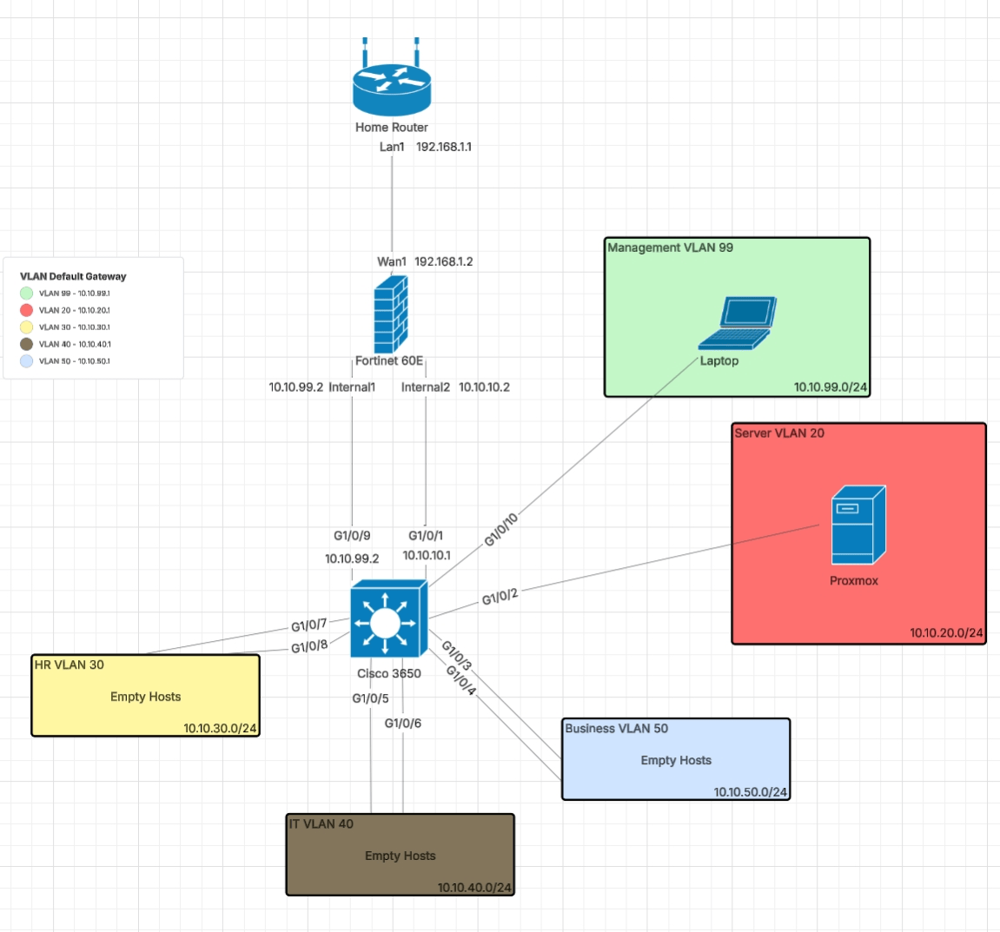
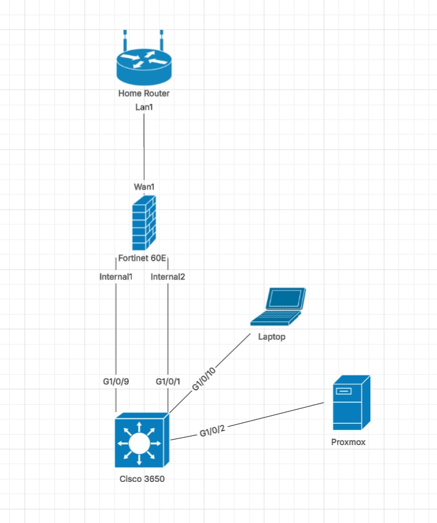

# Network Home Lab

Physical home lab originally built around a Cisco ASA 5505, Catalyst 3650-24PD,
and Cisco 891 router. The design has since moved to a Fortinet FortiGate 60E as
the primary firewall, with the Catalyst 3650 handling inter-VLAN routing
directly — the ASA is retired from the active path, and the 891 is cabled but
reserved for a future branch-site role.

Cisco gear is configured from the CLI. The FortiGate is configured through its
web GUI — that's Fortinet's normal management model; CLI there is mostly for
diagnostics (sniffer, debug) rather than day-to-day policy work.

---

## Topology




## Hardware

**FortiGate 60E** — primary perimeter firewall. NAT, routing, and firewall
policy for all internal VLANs live here.

**Catalyst 3650-24PD** — core switch. Handles VLAN tagging, SVIs, and
inter-VLAN routing, then hands off to the FortiGate for anything leaving the
internal network.

**Cisco ASA 5505** — retired from the active path. Kept as a baselined
reference; its outside address was reclaimed and reused on the FortiGate's
WAN1.

**Cisco 891-K9** — cabled, not yet in the routing path. Reserved for a
branch-site role once site-to-site IPsec VPN goes in.

**Dell OptiPlex 3070 (Proxmox)** — virtualization host on VLAN 20, for future
VM-based services (DNS, DHCP, test clients).

Console access: Keyspan USA-19HS on COM3 (ASA/891), mini-USB on COM5 (switch).

---

## What it does right now

Internal VLANs route through the Catalyst 3650 and out through the FortiGate
with NAT overload on WAN1.

```
Home Router 192.168.1.1
      |
  FortiGate 60E    WAN1 192.168.1.2 · Internal1 10.10.99.2 · Internal2 10.10.10.2
      |                    |
      |              Catalyst 3650
      |              VLANs 10/20/30/40/50/99
      |
   (891 — not yet in path)
```

VLANs 30 (HR), 40 (IT), and 50 (Business) have ports allocated and gateways
configured but no hosts attached yet — reserved for future test clients.

Next: DHCP and DNS (likely a Proxmox-hosted VM), then site-to-site IPsec to the
891, then Ansible once the topology settles.

---

## A few design choices

**The switch routes now.** Unlike the ASA-based design, the Catalyst 3650
handles inter-VLAN routing directly via its SVIs. The FortiGate doesn't see
every VLAN individually — just the two transit links it needs.

**Two separate links to the FortiGate.** Internal1 (10.10.99.x) carries
management/transit traffic; Internal2 (10.10.10.x) is a second routed link and
the switch's own default gateway out. These evolved as the design was reworked
rather than being planned up front.

**NAT policy scope.** The firewall policy's source object covers the whole
internal supernet (10.10.0.0/16) rather than per-VLAN objects, so adding a new
VLAN later doesn't require a new policy.

---

## Troubleshooting write-up

[Why outbound NAT wasn't working](write-ups/outbound-nat-troubleshooting.md) —
diagnosing a NAT policy that was configured correctly but scoped to the wrong
destination, and why pinging on-link devices gave false confidence that it was
working.

---

## Addressing

Full breakdown in [docs/ip-addressing.md](docs/ip-addressing.md).

---

## Layout

```
/configs      Device configurations (ASA/891/3650 historical; FortiGate export pending)
/docs         Addressing, inventory, topology, diagrams
/write-ups    Troubleshooting notes and design reasoning
```

Passwords, serials, and any identifying metadata are stripped from anything
committed here.

---

CCNA certified, working toward CCNP Enterprise.
