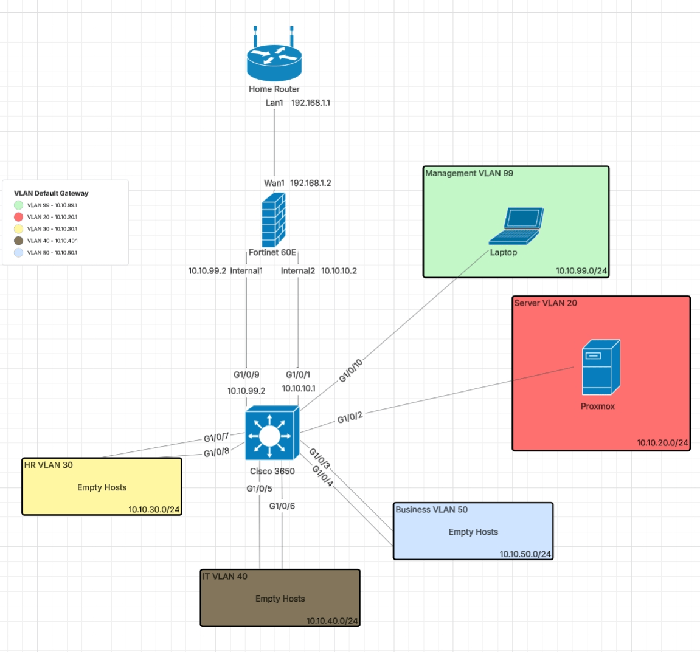
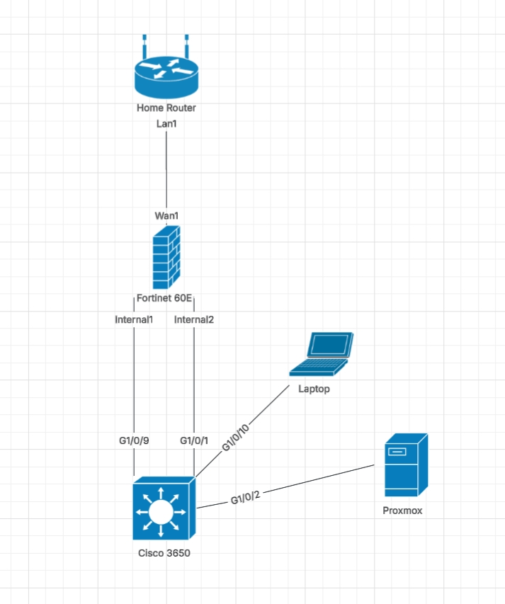

# Network Topology

## Logical Diagram

## Physical Diagram

## Physical Connections

| From | Interface | To | Interface |
|---|---|---|---|
| Home Router | LAN1 | FortiGate 60E | WAN1 |
| FortiGate 60E | Internal1 | Catalyst 3650 | G1/0/9 |
| FortiGate 60E | Internal2 | Catalyst 3650 | G1/0/1 |
| Management Laptop | — | Catalyst 3650 | G1/0/10 |
| Proxmox Host | — | Catalyst 3650 | G1/0/2 |

## VLANs

| VLAN | Name | Subnet | Switch Port(s) |
|---|---|---|---|
| 10 | Internal (transit to FortiGate) | 10.10.10.0/24 | G1/0/1 |
| 20 | Server | 10.10.20.0/24 | G1/0/2 |
| 30 | HR | 10.10.30.0/24 | G1/0/7, G1/0/8 |
| 40 | IT | 10.10.40.0/24 | G1/0/5, G1/0/6 |
| 50 | Business | 10.10.50.0/24 | G1/0/3, G1/0/4 |
| 99 | Management | 10.10.99.0/24 | G1/0/9, G1/0/10 |

VLANs 30, 40, and 50 have ports and gateways configured but no hosts attached
yet — reserved for future test clients.

## Management Access

Switch via mini-USB (COM5). FortiGate via its web GUI at `https://10.10.99.2`,
reached from the management VLAN (99).
